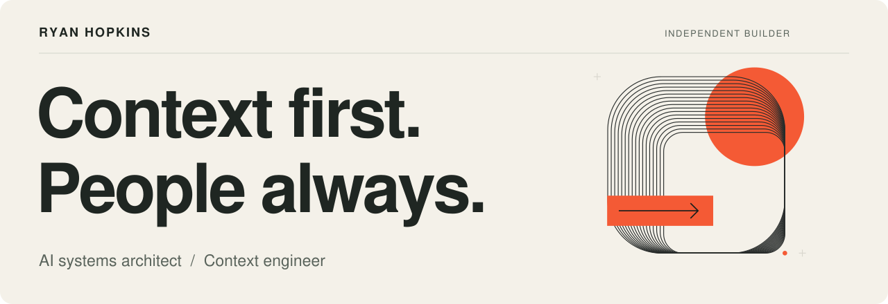
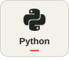
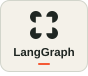
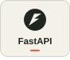
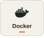

<a href="https://ryan-hopkins-systems-portfolio.ryan-hopkins.chatgpt.site/">
  <picture>
    <source media="(prefers-color-scheme: dark) and (max-width: 600px)" srcset="assets/profile-dark-mobile.svg">
    <source media="(max-width: 600px)" srcset="assets/profile-light-mobile.svg">
    <source media="(prefers-color-scheme: dark)" srcset="assets/profile-dark.svg">
    
  </picture>
</a>

  
  &nbsp;&nbsp; <a href="https://linkedin.com/in/ryan-hopkins-253344277">LinkedIn</a> &nbsp; / &nbsp; <a href="mailto:ryan.hopkins2@snhu.edu">Email</a>

### AI Systems Architect · Agentic Engineer

**Good systems start with understanding people.**

I architect, build, and operate AI systems end to end—from understanding the workflow and designing the architecture to agent orchestration, CLI and web experiences, integrations, QA, and production operations. My M.S. in **Industrial-Organizational Psychology** informs how I approach adoption: different people need different ways to understand, trust, and use technology at work.

At **iT1 Nucleos**, I work across Customer Success, integrations, and technical operations. I design for both the engineers who prefer a terminal and the colleagues who need a clear, approachable interface.

### Selected systems

| System | Focus |
| :-- | :-- |
| **Relay** | Internal AI operations platform evolving into a shared engineering harness. CLI and UI workflows, ClickUp investigations, browser-driven issue reproduction, and evidence-backed findings; automated fixes and broader QA are next steps. |
| **Seylumi** | Human-centered facility communication across web and Android, with real-world adoption and safeguards guiding the design. |
| **Sentinel** | A test-environment recovery pipeline for detecting changed onboarding flows and preparing reviewed repairs. |

Project stories, interfaces, and development status → **[Explore the work](https://ryan-hopkins-systems-portfolio.ryan-hopkins.chatgpt.site/#work)**

**The connective principle:** [System Immune Memory](https://ryan-hopkins-systems-portfolio.ryan-hopkins.chatgpt.site/#sim)—keep evidence, decisions, and verified lessons accessible to the next person or agent.

### Tools I build with

  <picture>
    <source media="(prefers-color-scheme: dark)" srcset="assets/tool-icons/python-dark.svg">
    
  </picture>
  <picture>
    <source media="(prefers-color-scheme: dark)" srcset="assets/tool-icons/typescript-dark.svg">
    
  </picture>
  <picture>
    <source media="(prefers-color-scheme: dark)" srcset="assets/tool-icons/langgraph-dark.svg">
    
  </picture>
  <picture>
    <source media="(prefers-color-scheme: dark)" srcset="assets/tool-icons/fastapi-dark.svg">
    
  </picture>
  <picture>
    <source media="(prefers-color-scheme: dark)" srcset="assets/tool-icons/nextdotjs-dark.svg">
    
  </picture>
  <picture>
    <source media="(prefers-color-scheme: dark)" srcset="assets/tool-icons/postgresql-dark.svg">
    
  </picture>
  <picture>
    <source media="(prefers-color-scheme: dark)" srcset="assets/tool-icons/docker-dark.svg">
    
  </picture>

---

**Exploring:** [AI research methodology · computational neuroscience · brain–computer interfaces](https://github.com/ProCO-RPHopkins/BBCI-Adaptive-Dynamics-Lab)  
**Open to:** AI Systems Architect · Agentic Engineer · Forward-Deployed Engineer roles · remote
